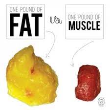
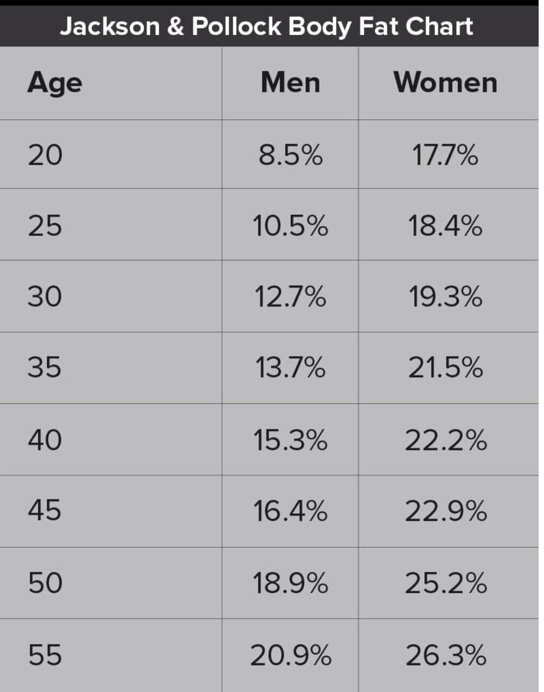

As I write this, a pound of gold is worth $21,880.08 and lead is worth $2,109.12 for the same pound.

Subcutaneous fat is fat that lies below the skin and above the muscle. It is your love handles, your pinch an inch. It is one of the ways, your body stores energy, it functions as padding to protect your bones and organs from injury.

Subcutaneous fat serves as a passageway for nerves and blood vessels between your skin and muscles. It insulates your body and helps regulate temperature. It attaches the dermis(skin) to the muscles and bones with a special connecting tissue.

Subcutaneous fat is an important part of your body. However, if you are storing too much fat, it can make you at higher risk for health problems, including heart disease, strokes, high blood pressure, type 2 diabetes, cancer , sleep apnea, fatty liver disease, and kidney disease.

People who tend to have more subcutaneous fat generally eat more calories than they burn, are sedentary, have too little muscle mass, get little aerobic activity, have diabetes, or are insulin resistant.

A pound of feathers has a volume of about 1/5 of a cubic meter, while one of lead takes up 0.0000067023092 of a cubic meter.

Visceral fat is fat found within your abdominal cavity. It surrounds your stomach, liver, intestines, and other internal organs. Some levels of visceral fat, are healthy and help protect your organs, but too much visceral fat can be dangerous for your health.

Diet and exercise play a key role in how much visceral fat you have. Stress also plays a role in your body storing visceral fat.

According to the National Institute of Health alterations in fatty acid metabolism, associated with visceral fat, are responsible for impaired insulin actions, because excessive circulating free fatty acids inhibit the ability of insulin to stimulate muscle glucose uptake to suppress the fatty glucose production.

Excess visceral fat is more harmful than excess subcutaneous fat, because Lipolysis of visceral adipose tissue releases free fatty acids into the portal vein, which then deliver triglycerides directly to the liver. These excessive triglyceride levels in the hepatic system may be an important factor in developing hepatic insulin resistance.

A pound of marshmallows will take up a lot more space than a pound of steel .

A pound of fat is bulky, fluffy, and about the size of a small grapefruit. A pound of muscle is hard, dense and about the size of a tangerine.

Not all pounds are created equal. The reality of the situation is that weight is not really a clear indicator of health. An extra 20 pounds of fat will give you a softer less toned appearance. While 20 pounds of lean muscle will make you look sculpted and firm.

While fat works to store energy, muscle, on the other hand, boosts your metabolism, which helps you to burn more calories at rest .

According to some research, regardless of your body mass index (BMI) or overall weight, people that have higher percentages of body fat have higher overall death rates. What this means is,even though people have a low bodyweight, if they have a poor muscle to fat ratio they are at higher risk for obesity related diseases.

So how do you determine how much muscle or fat you need? Recommended body fat percentages vary a bit.

There are also several ways to test your body fat composition:

-   Skinfold test
-   bioelectrical, impedance analysis (BIA )
-   hydrostatic weighing (underwater)
-   Air displacement BodPod
-   DX or DEXA scan

Once you find your body composition, the next step is to improve your percentage of muscle to fat ratio.

Here is where is circles back to what we feed our body. Science has proven time, and again that proper nutrition and exercise are the keys to a healthy life . Calories control weight.\
It is also important that you focus on your protein because it supports lean muscle mass so learning what macro nutrients are needed to either lose fat or gain muscle is crucial. Just moving burns calories and cardiovascular exercise is important for your overall health. In order to gain muscle, it is necessary to incorporate strength or resistance training into your lifestyle.

Stay consistent and consult with a healthcare professional.
