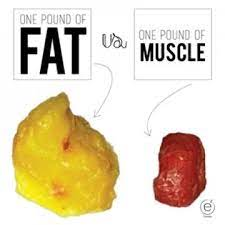
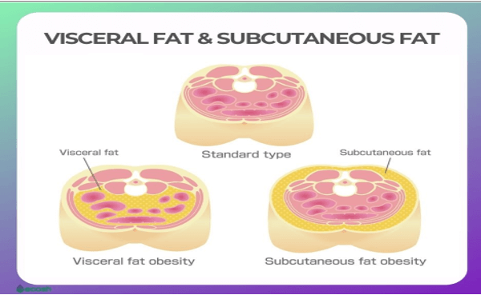

Body contouring is an appealing option for anyone hoping to eliminate stubborn fat pockets. [Cryolipolysis](/springfield/cryolipolysis/) is one of the safest nonsurgical body contouring techniques available today. There is no downtime, no surgery, and you get great results. That is, if you are the right candidate.

-   Am I the right candidate? Ask yourself the following:
-   Do I Have at least 1 inch of pinchable subcutaneous fat ?
-   Is my BMI below 30 ?
-   Am I trying to target trouble spot areas like bra-line , upper arms, love-handles, or double chin?
-   Are my expectations realistic?

## Cryo-lipolysis is not a weight loss treatment
However, you may see dramatic results. Those results are due to the fact that a pound of subcutaneous fat is about the size of a grapefruit, and takes up a lot more space when compared to a pound of muscle. You can expect to see a 20 to 25% reduction in fat with each treatment. those results will continue to compound with multiple treatments.

Cryo-lipolysis is a body contouring treatment and should not be thought of as a weight loss option. A BMI score below 30 is advised for most body areas except for the double chin area where the BMI score should be below 43.

If your BMI is above 30 and you are satisfied with your weight, but you have a trouble spot like your bra, fat or your upper arms then CoolSculpting ®️is still a good treatment option .

If your goal is to lose weight, then cryo- lipolysis can help push you in the right direction. Many patients find it more manageable to lose weight after a treatment because they’re more motivated and they made a financial investment in themselves.

## Targets the Subcutaneous Fat

CoolSculpting®️ treatments, target, stubborn, pinchable fat above the muscle wall. This is known as subcutaneous fat. Subcutaneous fat can be very challenging to get rid of with diet and exercise alone. This is where cryo-lipolysis can make a definite impact on your body.

If the fat that you are targeting, however, is below the muscle wall, cryo-lipolysis may not be the treatment for you. Fat below the muscle, known as visceral fat, is usually located in the abdominal cavity surrounding organs. The visceral fat is directly linked to several health issues and should be targeted with lifestyle changes and other medical interventions.

The Cryo-lipolysis procedure uses controlled cooling to freeze the fat cells in targeted treatment areas. These frozen fat cells then die and are naturally eliminated by the body through the lymphatic system. Once eliminated the treated fat cells are gone for good. By incorporating a healthy lifestyle, you can maintain results for years to come.

By setting yourself realistic expectation ,and understanding that CoolSculpting®️ is not designed to be a weight loss tool, or a significant fat removal method, but an adjunt to your healthy lifestyle, you can set yourself up for amazing transformations. Results of cryolipolysis can be seen in just a few weeks and will continue to improve for several months after your final treatment.

The cost of the procedure can range anywhere from $600-$1000 per treatment area depending on the body part and the number of sessions needed to achieve your goals. Sessions usually range from 30 minutes-1 HOUR depending on the area being treated and patient specific needs. It typically takes about 3 to 4 months for the full results to become apparent .

The best and most accurate way to find out if Cryolipolysis is right for you is to schedule a complementary consultation with  [A New You Women’s Clinic](/). We will answer your general questions and you will receive a thorough evaluation to determine if you’re a great candidate for CoolSculpting.®️ Contact us today to schedule a consultation
