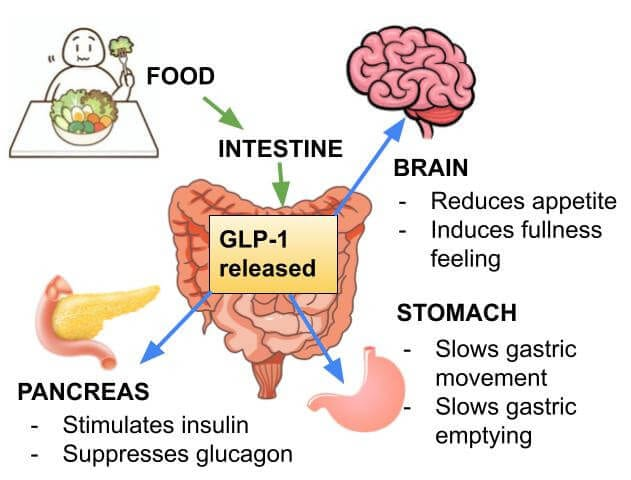
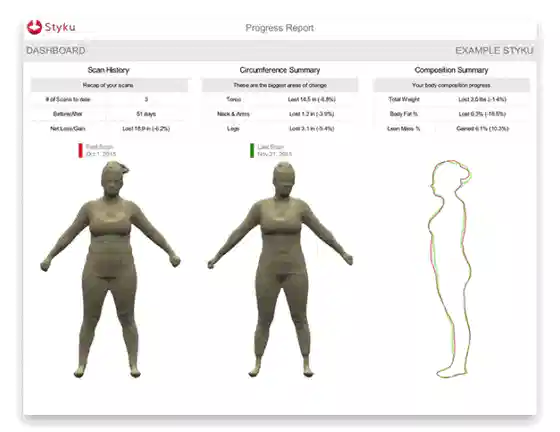
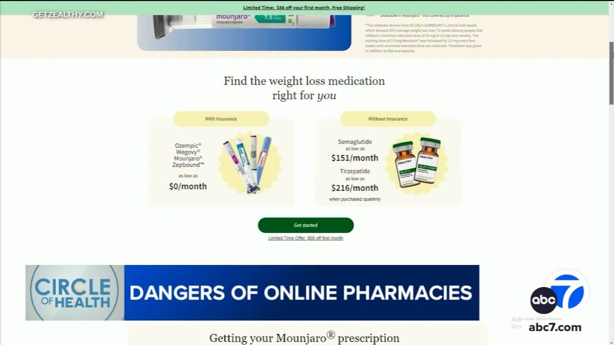

GLP-1 medications have truly been a game-changer in weight loss and metabolic health—but with that has come a lot of noise.

You’ve probably seen it in Facebook groups or online forums…\
People talking about ***“Ozempic face,**” **hair loss, sarcopenia, muscle wasting**,* or even where to inject for “better results.”

From head to hoo-ha, let’s clear the air and keep you informed—because this isn’t just about weight loss… it’s about understanding what’s actually happening in your body.

## What GLP-1 (and GIP) Medications Actually Do
**Glucagon-like peptide-1 (GLP-1)** and **glucose-dependent insulinotropic polypeptide (GIP)** are naturally occurring hormones produced in the gut in response to food intake.

GLP-1 medications *mimic natural hormones* in your body that help regulate insulin, stabilize blood sugar, slow digestion, and reduce appetite.

That’s why people feel fuller longer, have fewer cravings, and start to see weight come off.

GIP works alongside GLP-1, enhancing insulin response and supporting metabolic function. Medications like tirzepatide combine these pathways—and even newer triple agonists are targeting multiple receptors for even more advanced metabolic support.

But here’s the key…

These medications are **tools**—not magic.

And how they’re used matters.

## The Concerns You’re Hearing (and Why They Happen)
Let’s talk about the big ones.

### “Ozempic Face” (Facial Volume Loss)
This isn’t caused by the medication itself—it’s caused by **rapid, unsupported weight loss**.

When weight drops too quickly, fat pads in the face shrink faster than the skin can adapt, which can create a hollow or aged appearance.

**What matters is how the weight loss is managed.**

### Hair Loss
Hair loss during weight loss is typically related to **nutrient deficiencies or stress on the body**, not the medication itself.

When the body isn’t supported properly, it prioritizes essential functions—and hair takes a back seat.

### Sarcopenia (Muscle Loss)
This is one of the most important concerns.

If weight loss is happening without adequate protein, movement, and monitoring, the body can lose **lean muscle instead of just fat**—which slows metabolism and affects long-term results.

## So How Do You Prevent These Issues?
This is where working with the **right provider** matters.

Not someone handing you a prescription and sending you on your way…

But someone who is actually watching what’s happening in your body.

That means:

-   Monitoring **body fat vs. muscle mass**
-   Supporting **nutrition and protein intake**
-   Encouraging **strength-based movement (not extreme workouts—just intentional movement)**
-   Adjusting your plan as your body responds

We also incorporate support like **lipotropic injections**, which contain nutrients such as B vitamins and amino acids that help your body metabolize fat more efficiently, support energy, and prevent nutrient gaps during weight loss.

Because the goal isn’t just to lose weight…

It’s to lose it **well**.

## The Benefits Go Far Beyond Weight Loss
This is the part that doesn’t get talked about enough.

### ❤️ Cardiovascular Health
According to a study published in [Circulation,](https://www.ahajournals.org/doi/10.1161/CIRCULATIONAHA.121.056770?utm) GLP-1 receptor agonists have been shown to reduce major cardiovascular events—like heart attack and stroke—by approximately **13–14%**.

This means you’re not just losing weight…

You’re actively supporting long-term heart health.

### 🦵 Joint Pain & Mobility
Weight loss alone reduces stress on joints—but GLP-1s appear to go even further.

Clinical trial data published in the *[New England Journal of Medicine](https://www.nejm.org/doi/full/10.1056/NEJMoa2032183?utm_source=chatgpt.com)* showed that patients using semaglutide not only lost weight but also experienced **reduced joint pain and improved mobility**, particularly in those with osteoarthritis.

Less inflammation + less load = better movement.

### 🧠 Mental Health & the Gut-Brain Axis
Emerging research shows GLP-1s interact with brain pathways that influence **appetite, mood, and motivation**.

Some studies suggest improvements in [emotional eating patterns, mood stability, and overall well-being](https://jamanetwork.com/journals/jamapsychiatry/fullarticle/2810737?utm).

This is where the gut-brain connection becomes very real.

### 🩸 Blood Sugar & Metabolic Stability
G[LP-1s help regulate insulin and reduce blood sugar spikes](https://pmc.ncbi.nlm.nih.gov/articles/PMC7196453/?utm_), leading to:

-   Fewer cravings
-   More stable energy
-   Improved metabolic function

This is one of the foundational reasons they’re so effective.

## ⚠️ A Quick Word About Online Ordering
With the rise in popularity, there’s also been an increase in **online ordering and DIY use**.

Convenient? Maybe.

Safe? Not always.

The quality, dosing, and follow-up care matter more than most people realize.

This is not something that should be done blindly or based on what someone in a Facebook group is doing.

## The Bottom Line
GLP-1 medications can be incredibly effective.

But they are **not for everyone**—and they are not meant to be used without guidance.

If you’re considering this path, the most important thing you can do is find a provider who:

-   Looks at the **whole person**
-   Monitors your progress
-   Supports your body along the way
-   Adjusts your plan based on YOU

Because this isn’t just about losing weight.

It’s about doing it in a way that supports your:

-   Metabolism
-   Muscle
-   Hormones
-   Long-term health

From head to hoo-ha… the whole picture matters.

If this topic has you thinking a little differently about weight loss, hormones, and how your body actually works…

I’m hosting a complimentary seminar in April where we’ll go deeper into detox pathways, the hepatic system, and how this all connects to weight loss, energy, and overall health.

It’s designed to help you understand what’s really going on—not just what you’re being told.

👉 Learn more about our personalized approach here:\
[https://anewyouwoman.com](/)

