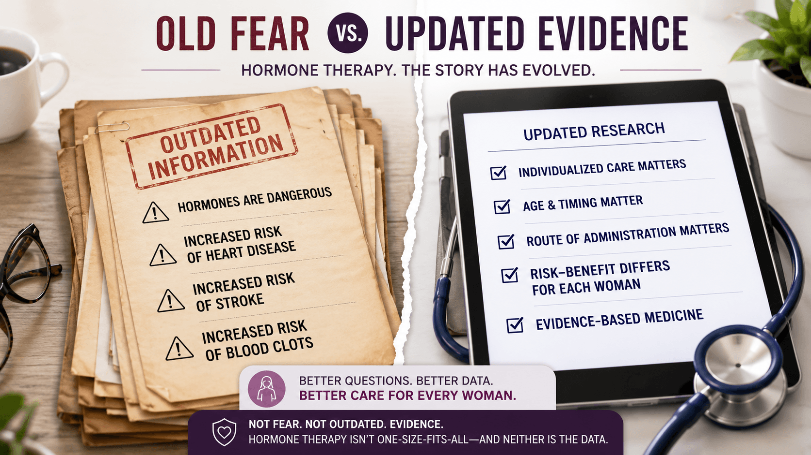
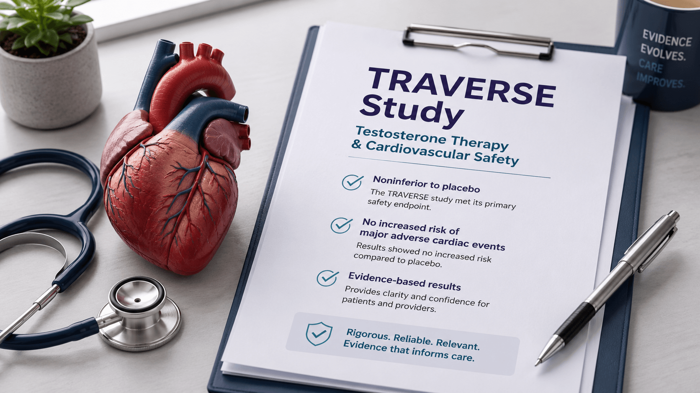
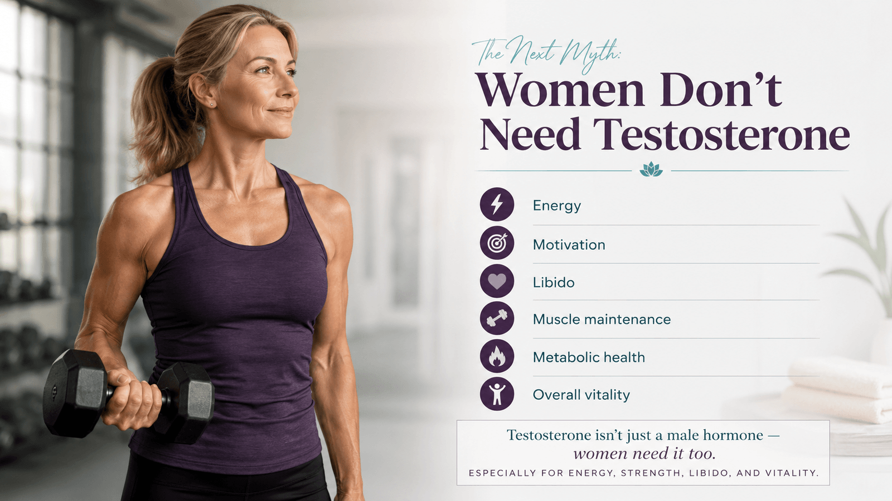
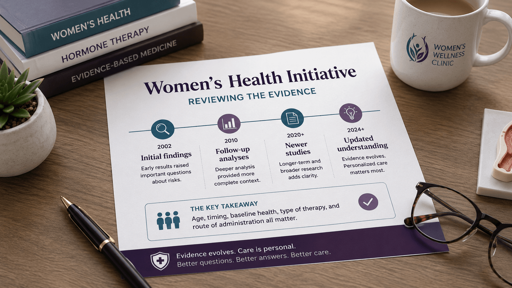
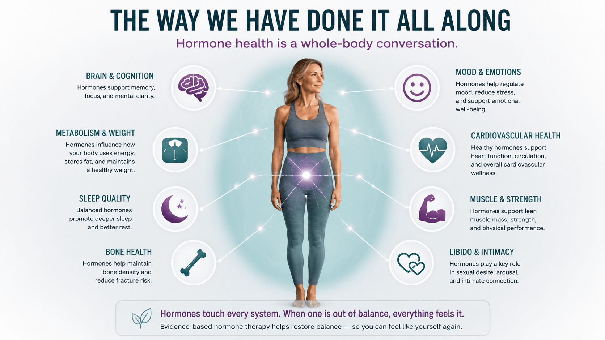

Over the past couple of months, we’ve been talking a lot about weight loss, metabolism, insulin resistance, inflammation, muscle, stress, and the way the body changes as we age.

And if you’ve followed along, you’ve probably noticed a common thread: the body does not work in isolated little boxes.

Your weight is connected to your hormones.\
Your sleep is connected to your cortisol.\
Your muscle is connected to testosterone.\
Your mood, energy, libido, brain fog, hot flashes, vaginal health, urinary health, and even your ability to age well are all connected to the hormonal conversation happening inside your body every single day.

So as we move into June, I want to take the conversation one layer deeper.

Because when we talk about hormone therapy, many people still come into the conversation carrying fear.

Fear that hormone therapy will automatically cause a blood clot.\
Fear that it will cause a stroke.\
Fear that estrogen is dangerous.\
Fear that progesterone is dangerous.\
Fear that testosterone is only for men.\
Fear that women should just “tough it out” because this is all just part of aging.

And honestly?

Many of us were taught that way. I was taught that way too.

It was not because providers were trying to harm women. It was not malicious. It was not because everyone had bad intentions. It was because, at the time, we did not know what we know now.

Medicine evolves. Research evolves. Our understanding evolves.

And some providers are still learning. Some were trained under the old fear-based messaging and have not yet had the opportunity to dig into the newer data, the follow-up studies, and the evolving conversation around hormone therapy.

That is why education matters.

A lot of fear around hormone therapy came from outdated information, misunderstood research, and years of women being handed warning labels instead of real conversations.

It is time to have the real conversation.

## The First Myth: Hormone Therapy Automatically Causes Heart Attacks, Strokes, or Blood Clots

One of the biggest concerns I hear around hormone therapy is cardiovascular risk.

Patients worry that hormone therapy is going to cause a heart attack, a stroke, or a blood clot. And that fear did not come out of nowhere. For years, hormone therapy was talked about like it was automatically dangerous, especially after the Women’s Health Initiative created widespread concern around estrogen and progesterone therapy.

But here is where we have to slow down and look at the details.

Not all hormone therapy is the same.

The patient matters.\
The timing matters.\
The delivery method matters.\
The type of hormone matters.\
The dose matters.\
The monitoring matters.

That is why hormone therapy should never be treated like a one-size-fits-all prescription. It should be individualized, monitored, and based on the full clinical picture.

This is also why updated research matters so much.

## What the TRAVERSE Study Helped Clarify

The TRAVERSE study was designed to answer an important safety question: does testosterone replacement therapy increase major cardiovascular risk in men who have low testosterone and either existing cardiovascular disease or a higher risk for it?

That matters because, for years, testosterone therapy carried a shadow of fear around heart attacks and strokes.

[The TRAVERSE trial found that testosterone replacement therapy was noninferior to placebo when looking at major adverse cardiac events, meaning it did not show an increased risk of major cardiovascular events compared with placebo in the studied population.](https://www.nejm.org/doi/full/10.1056/NEJMoa2215025?utm_source=chatgpt.com)

Now, does that mean testosterone therapy is for everyone with no need for evaluation? No.

That is not what responsible hormone care means.

It means we stop using blanket fear and start using individualized, medically monitored care.

It means we look at the person in front of us.

It means we evaluate symptoms, labs, risk factors, goals, and overall health instead of assuming that every hormone conversation is automatically dangerous.

And that is how we have approached hormone optimization all along.

## The Next Myth: Women Don’t Need Testosterone

**This one needs to go**!

Women absolutely have testosterone. Women absolutely need testosterone. We just need it in different amounts than men.

Testosterone plays a role in energy, motivation, mood, libido, muscle maintenance, metabolic health, and overall vitality. When women are low, they may not walk in saying, “I think my testosterone is low.”

They usually say things like:

“I’m exhausted.”\
“I have no drive.”\
“I don’t feel like myself.”\
“My workouts aren’t working anymore.”\
“My libido is gone.”\
“I feel flat.”\
“I’m doing everything right and still gaining weight.”

That is why we do not guess.

We listen.\
We test.\
We look at symptoms.\
We look at labs.\
We look at the whole picture.

Because women were not designed to simply fade quietly into the second half of life.

## Now Let’s Talk About Estrogen and Progesterone

If testosterone has been misunderstood, estrogen and progesterone have been practically villainized.

And a lot of that goes back to the Women’s Health Initiative.

The Women’s Health Initiative was a major study that changed the way hormone therapy was viewed for decades. After the initial findings were released, many women were taken off hormone therapy, providers became fearful, and hormone replacement became associated with increased risks of breast cancer, heart disease, blood clots, stroke, and dementia.

But the problem is that the message became oversimplified.

Instead of asking deeper questions, the public message became:

Hormones are dangerous.

But that is not the whole story.

[Over time, follow-up analysis and newer studies have helped clarify that age, timing, baseline health, type of hormone therapy, and route of administration all matter.](https://pmc.ncbi.nlm.nih.gov/articles/PMC4834454/) The “timing hypothesis” looks at the idea that hormone therapy may have a different risk-benefit profile when started closer to [menopause](/menopause/) versus much later in life.

In other words, a healthy woman in her early menopause transition is not the same clinical picture as someone decades past menopause with existing health risks.

That matters.

And frankly, women deserved that nuance from the beginning.

## Even the FDA Has Shifted the Conversation

This is where the conversation gets really important.

[In November 2025, the FDA announced that it was initiating removal of broad black box warnings from many menopausal hormone therapy products.](https://www.hhs.gov/press-room/fact-sheet-fda-initiates-removal-of-black-box-warnings-from-menopausal-hormone-replacement-therapy-products.html) Specifically, the agency stated it was working with companies to update labeling to remove references to risks of cardiovascular disease, breast cancer, and probable dementia from certain hormone therapy labels. The FDA also stated that the boxed warning for endometrial cancer would remain for systemic estrogen-alone products.

[Then in February 2026, the FDA announced approval of labeling changes for the first batch of menopausal hormone therapy products after that November 2025 review process.](https://www.fda.gov/news-events/press-announcements/fda-approves-labeling-changes-menopausal-hormone-therapy-products)

That does not mean hormone therapy is risk-free.

It means the old warning language was too broad and did not reflect the more individualized way hormone therapy should be discussed today.

That is the message I want women to hear clearly:

Hormone therapy is not about handing everyone the same prescription.

It is about asking better questions.

Where are you in the menopause transition?\
Do you still have a uterus?\
What are your symptoms?\
What are your labs showing?\
What is your cardiovascular risk?\
What is your family history?\
What route of therapy makes the most sense?\
What does your body actually need?

That is real hormone care.

## Hormone Therapy Is Not Just About Hot Flashes

Hot flashes matter. Night sweats matter. Sleep matters.

But hormone optimization is about more than just putting out the loudest fire.

It is about looking at the whole woman.

Estrogen supports the conversation around brain health, bone health, skin, vaginal tissue, urinary health, sleep, and cardiovascular health.

Progesterone plays a role in sleep, nervous system support, uterine protection when estrogen is used in women with a uterus, and overall hormonal balance.

Testosterone supports energy, libido, strength, lean muscle, motivation, and vitality.

And when these hormones begin to decline or fall out of balance, women often feel like they are losing pieces of themselves.

They may be told their labs are “normal.”\
They may be told they are just getting older.\
They may be offered antidepressants, sleep medication, or told to lose weight.\
They may be told this is just menopause.

But “common” does not mean “normal,” and aging does not have to mean suffering.

## How This Ties Back to Weight Loss, Muscle, and Metabolic Health

This is why our hormone conversation connects directly to the topics we have already been covering.

In previous weight loss discussions, we talked about insulin resistance, cortisol, inflammation, sleep, muscle, and metabolism. We talked about why weight loss is not simply about willpower or calories. We talked about how the body responds to stress, blood sugar swings, poor sleep, and loss of muscle.

Hormones are part of that same conversation.

If cortisol is high, sleep is poor, insulin is elevated, muscle is declining, thyroid function is off, and sex hormones are low, the body is not going to respond the same way it did at 25.

This is why we look at the whole picture.

Not because it is trendy.

Because it is necessary.

## The Way We Have Done It All Along

[At A New You Women’s Clinic, hormone therapy is not a quick prescription and a pat on the back.](/)

It is a medical conversation.

We look at symptoms.\
We look at labs.\
We look at health history.\
We look at goals.\
We look at risk factors.\
We look at the whole person.

We offer hormone therapy options including testosterone, estradiol, and progesterone when appropriate, and we continue to educate patients on why individualized care matters.

Because the goal is not to chase youth.

The goal is to support energy, strength, confidence, clarity, sleep, intimacy, metabolism, and long-term wellness.

From head to hoo-ha, the body is connected.

And when women understand that, they can stop being afraid of the conversation and start making informed decisions about their care.

## Closing Thought

For too long, hormone therapy has been surrounded by fear, confusion, and outdated messaging.

But the conversation is changing.

The research has evolved.\
The FDA labeling is shifting.\
The old blanket warnings are being reconsidered.\
And women are finally starting to ask better questions.

That is a good thing.

Because you deserve more than “just deal with it.”

You deserve education.\
You deserve options.\
You deserve individualized care.\
You deserve to understand what is happening in your body.

And that is exactly the conversation we are going to keep having.
