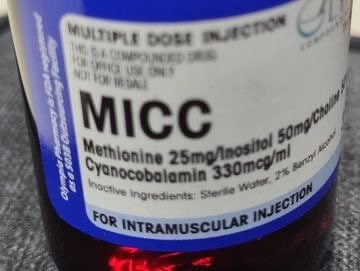

Methionine, inositol, choline, and cyanocobalamin (also known as vitamin B12) are often combined in what is known as MICC injections or “skinny shots.” While there is limited scientific evidence specifically on the use of MICC injections for weight loss, each component is believed to offer certain benefits:

## Methionine: Methionine is an essential amino acid that plays a role in metabolism and fat breakdown. It may help support the liver’s function in processing and eliminating fat.

Methionine is an essential amino acid, meaning that it cannot be produced by the body and must be obtained through the diet. It plays several important roles in the body, including:

1.  Protein synthesis: Methionine is a building block for protein synthesis, which is crucial for growth, repair, and maintenance of tissues in the body.
2.  Detoxification: Methionine is involved in the synthesis of glutathione, a powerful antioxidant that helps neutralize harmful toxins and free radicals in the body.
3.  Lipid metabolism: Methionine is involved in the breakdown of fats and the prevention of fatty buildup in the liver. It aids in the synthesis of phospholipids, which are essential for the structure and function of cell membranes.
4.  Homocysteine regulation: Methionine is involved in the conversion of homocysteine, an amino acid, into other beneficial substances. Elevated levels of homocysteine in the blood have been associated with an increased risk of cardiovascular disease.

## Inositol: Inositol is a naturally occurring compound that is involved in various cellular processes. It may help regulate insulin levels, support liver health, and assist in the breakdown of fats.

Inositol is a naturally occurring compound that belongs to the vitamin B family. It is often referred to as vitamin B8, although it is not officially recognized as a vitamin. Inositol is found in various foods, such as fruits, nuts, and grains.\
In the body, inositol plays a crucial role in cell signaling and is involved in many biological processes. It is a component of cell membranes, where it helps regulate membrane fluidity and integrity. Inositol also acts as a secondary messenger in signal transduction pathways, helping to transmit signals within cells.\
Inositol has been studied for its potential therapeutic effects on a variety of conditions, including mental health disorders such as depression, anxiety, and obsessive-compulsive disorder. It is believed to have a calming effect on the central nervous system and may help regulate mood and reduce symptoms of these disorders.

Additionally, inositol has been investigated for its potential role in improving insulin sensitivity and managing conditions like polycystic ovary syndrome (PCOS) and gestational diabetes. It may also have beneficial effects on liver health, lipid metabolism, and cholesterol levels.

## Choline: Choline is a nutrient that is important for the proper function of cells, the nervous system, and metabolism. It is involved in fat metabolism and may support liver health.

Choline is an essential nutrient that is often grouped with the B vitamins. It is similar to inositol in its chemical structure and functions. Choline is found in various foods, including eggs, meat, fish, dairy products, and certain plant-based sources like soybeans and quinoa.

In the body, choline plays a vital role in several important functions. It is a precursor for the neurotransmitter acetylcholine, which is involved in memory, learning, and muscle control. Choline is also a component of cell membranes and is necessary for their structure and function. Additionally, choline is involved in the metabolism of fats and cholesterol, as well as the production of certain compounds involved in cell signaling.

Choline is particularly important during pregnancy and early childhood. It contributes to brain development and helps prevent neural tube defects in unborn babies. Adequate choline intake is also important for liver function, as it helps with the transport and metabolism of fat in the liver.

Choline deficiency is rare but can lead to liver damage, muscle damage, and neurological disorders. The recommended daily intake of choline varies depending on age, sex, and life stage, with higher requirements during pregnancy and lactation.

## Cyanocobalamin (Vitamin B12): Vitamin B12 is essential for various bodily functions, including energy production and the metabolism of fats and proteins. It may help boost energy levels and support overall metabolic function.

Cyanocobalamin is a synthetic form of vitamin B12, which is essential for the normal functioning of the brain, nervous system, and the production of red blood cells. While vitamin B12 is often associated with increased energy levels and metabolism, there is no direct evidence to suggest that cyanocobalamin alone can enhance weight loss.

However, vitamin B12 deficiency can lead to symptoms such as fatigue, weakness, and difficulty in maintaining a healthy weight. In some cases, individuals with a deficiency may experience weight loss when they receive vitamin B12 supplementation.

## Conclusion

In conclusion, the “skinny shot” or MICC injection is often marketed as a quick fix for weight loss. However, it is important to recognize that weight loss is a multifaceted process that requires a balanced diet, regular exercise, and a healthy lifestyle.

Before considering any weight loss supplement or treatment, it is essential to consult with a healthcare professional who can provide personalized guidance and help develop a comprehensive plan that includes proper nutrition, exercise, and other lifestyle modifications.

Remember, the key to successful and sustainable weight loss lies in adopting healthy habits and making long-term lifestyle changes, rather than relying on quick fixes or shortcuts.

It’s important to note that weight loss is a complex process influenced by various factors, including diet, exercise, and overall lifestyle. While the MICC injections can play a role in supporting overall health, it is not a magic solution for weight loss.
