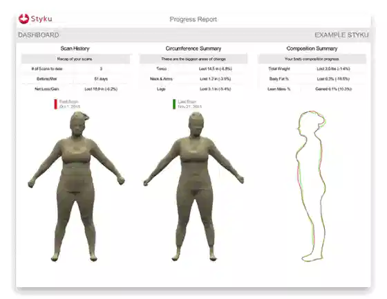

In a previous blog, I talked about why “[calories in, calories out](/weight-loss-is-not-about-eating-less-it-is-about-eating-better/)” is missing the point.

Because it is.

Weight loss is not just about eating less. It is not just about cutting calories. It is not just about forcing your body into submission and hoping it finally cooperates.

Real weight loss has to look at the whole picture.

What are you eating?\
How is your body responding?\
Are you losing fat or are you losing muscle?\
Are you moving your body in a way that actually supports your future?\
Do you have accountability when life gets messy?\
Do you have someone helping you adjust the plan when what you are doing is not working?

That is the part people often miss.

Most people come into weight loss thinking about one thing: the number on the scale.

And I understand why. That is what we have all been trained to look at.

But the scale does not tell the whole story.

## BMI and Pounds Do Not Tell the Whole Story
One of the measurements people hear about all the time is BMI.

BMI is basically a calculation using your height and your weight. That is it. It does not know how much muscle you have. It does not know how much body fat you have. It does not know your metabolic health. It does not know your strength, your hormones, your inflammation, your energy, or how you actually feel.

It is a number.

And honestly, it is a very limited number.

The same thing is true with pounds on a scale.

People get very attached to the pounds. They want to know, “How much do I weigh?” or “How many pounds did I lose?”

But a pound of fat and a pound of muscle are not the same thing inside the body.

Yes, they both weigh a pound. But they do not function the same way. They do not look the same on the body. They do not impact your metabolism the same way.

Muscle is active tissue. It supports your metabolism. It supports your strength. It supports your joints. It helps with blood sugar. It helps with mobility. It helps protect your body as you age.

Fat tissue, especially excess visceral fat, is very different. It can contribute to inflammation, hormone disruption, insulin resistance, and increased health risks.

So when we are looking at weight loss, I do not just want to know what the scale says.

I want to know what your body is made of.

## Body Composition Matters
This is why body composition matters.

If someone weighs 194 pounds and has 70% lean mass and 30% body fat, that tells me something very different than if someone weighs 194 pounds and has much lower muscle mass and much higher body fat.

The number on the scale may be the same, but the health picture is not the same.

That is why I do not want people obsessing over pounds alone.

I want to know: Are we protecting muscle? Are we losing fat? Are we improving strength? Are clothes fitting better? Is energy improving? Is blood sugar improving? Is inflammation coming down? Is the body functioning better?

Because that is what matters.

The goal is not to become a smaller, weaker version of yourself.

The goal is to become healthier, stronger, and more metabolically stable.

That is a very different conversation

## Weight Loss Should Not Mean Muscle Loss
One of the biggest mistakes people make when trying to lose weight is losing muscle along with fat.

This happens all the time with extreme dieting, under-eating, poor protein intake, and weight loss plans that only focus on the scale.

People get excited because the number drops, but what did they actually lose?

Did they lose fat?\
Did they lose water?\
Did they lose muscle?\
Did they slow their metabolism down in the process?

That matters.

Because muscle is protective.

Muscle helps you stay strong. It helps you stay mobile. It helps you age better. It helps prevent falls. It helps you get up off the floor if you do fall. It supports your bones, joints, metabolism, and insulin sensitivity.

This is why strength and muscle matter so much in weight loss.

We are not just trying to make the scale go down.

We are trying to build a body that can carry you through life.

## Cardio Is Good, But Strength Is Non-Negotiable
Now let’s talk about movement.

A lot of people will say, “I exercise. I do cardio.”

And cardio is good. I am not saying it is not. Walking, biking, swimming, dancing, hiking, whatever gets you moving — that all matters.

Cardio supports your heart, your circulation, your endurance, your mood, and your overall health.

But cardio alone is not enough.

Cardio is not what gets you up off the floor if you fall.

Strength does that.

Core strength does that.\
Leg strength does that.\
Upper body strength does that.\
Balance and stability do that.

And strength training does not have to mean becoming a gym person if that is not who you are.

Strength training can be push-ups, sit-ups, planks, squats, lunges, pull-ups, resistance bands, dumbbells, machines at the gym, or lifting heavier weights if that is what you enjoy.

The point is not that everyone has to do the same thing.

The point is that you have to find some form of strength work that you can do consistently.

Because consistency is what changes the body.

## Daily Patterns Matter More Than Short Bursts of Motivation
Most people do not fail because they do not care.

They fail because life happens.

They get motivated. They start a plan. They buy the book. They order the food. They save the videos. They get the workout clothes. They tell themselves, “This time I am really going to do it.”

And then real life walks in.

You work late.\
The kids need something.\
A friend has a crisis.\
You are exhausted.\
You did not meal prep.\
You missed the workout.\
You ate something you did not plan to eat.\
And suddenly it feels like you blew it.

That is where people get stuck.

They think, “Well, I already messed up, so I will start over Monday.”

But you do not have to wait until Monday.

You do not have to wait until the first of the month.\
You do not have to wait until the holidays are over.\
You do not have to wait until life calms down.

Because life is not going to completely calm down.

That is why weight loss cannot be built around perfection.

It has to be built around progress.

## Accountability Is Not About Shame
Accountability gets misunderstood sometimes.

People hear accountability and think it means someone is going to scold them, judge them, or make them feel bad when life gets messy.

That is not what real accountability should be.

Accountability should be support.

It is having someone say, “Okay, last week was chaotic. Let’s look at what happened. What can we adjust? What is the next right step?”

It is not about starting over.

It is about continuing.

It is about learning how to live in the real world and still make progress.

That is where the 80/20 mindset matters.

You do not have to be perfect. You do not have to eat perfectly, exercise perfectly, sleep perfectly, or have a perfectly organized life to be successful.

You need direction.\
You need consistency.\
You need support.\
You need the ability to adjust without quitting.

That is the difference.

## Structure Helps People Succeed
This is why structured plans work better for so many people.

Not because people need to be controlled.

But because most people need a framework.

They need to know what they are working on.\
They need to know what is being measured.\
They need to know what matters.\
They need to know when something needs to be adjusted.\
They need someone looking at the whole picture.

A good weight loss plan is not just, “[Here is medication, good luck.”](/weight-loss/)

It should look at nutrition, movement, muscle, fat loss, labs, [hormones](/the-benefits-of-bioidentical-hormone-replacement-therapy/), blood sugar, gut health, inflammation, sleep, stress, and how the person is actually doing in real life.

Because weight loss is not happening in a vacuum.

It is happening while you are working, parenting, caregiving, running errands, paying bills, dealing with stress, trying to sleep, and living your actual life.

A plan has to fit real life, or people will not stick with it.

## This Is Where Support Changes Everything
When someone has [regular support](/subscription-plans/), they do not have to carry the whole process alone.

They have a place to come back to.\
They have someone helping them look at what is working and what is not.\
They have someone reminding them that one rough week is not failure.\
They have someone helping them focus on the right measurements, not just the scale.\
They have someone helping them protect muscle while losing fat.\
They have someone helping them keep going.

That matters.

Because weight loss is not just about starting.

A lot of people can start.

The harder part is continuing when motivation wears off, life gets complicated, and the first plan needs adjusting.

That is where support becomes so important.

## Weight Loss Is Quality Over Quantity
At the end of the day, weight loss should not just be about becoming less.

Less weight.\
Less food.\
Less space.\
Less of yourself.

That is not the goal.

The goal is better.

Better body composition.\
Better strength.\
Better energy.\
Better blood sugar.\
Better mobility.\
Better confidence.\
Better health.

It is quality over quantity.

I would rather see someone lose body fat, preserve muscle, build strength, improve their health markers, and feel better in their body than chase an arbitrary number on the scale.

Because the scale is only one piece of information.

It is not the whole story.

## Final Thoughts
Weight loss works best when the pieces come together.

-   Nutrition matters.
-   Movement matters
-   Strength training matters
-   Body composition matters
-   Accountability matters
-   Support matters
-   Consistency matters

And yes, [medication can be a helpful tool for the right person](/what-glp-1-medications-wont-fix-but-you-still-have-to-understand/), but it should never be the only piece of the plan.

The goal is not just to lose weight quickly.

The goal is to build a healthier body that can keep going.

That means feeding the body well, moving it consistently, protecting muscle, reducing excess fat, and having the right support in place when life gets messy.

Because real weight loss is not about perfection.

It is about progress.

It is about learning your body.\
Supporting your body.\
Building strength.\
Creating structure.\
And continuing forward, even when the week did not go exactly as planned.

That is where real change happens.
