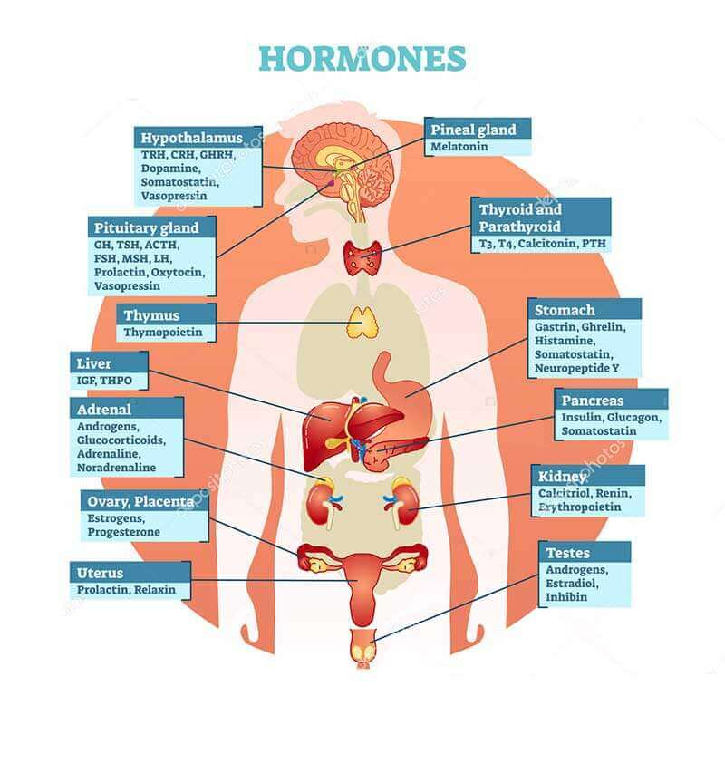
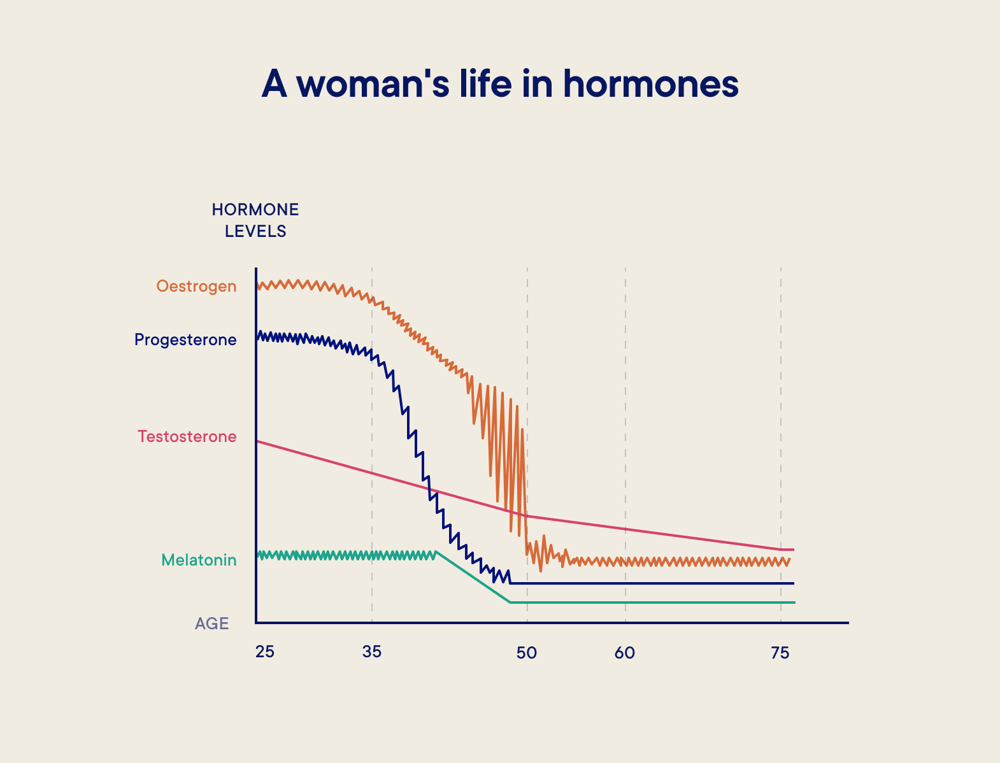

Fountain of youth, by JT digital art

## Introduction

Aging is an inevitable part of life, and as we grow older, our bodies undergo numerous changes, both internally and externally. One of the key factors influencing the aging process is the decline in hormone production. However, recent research has shed light on the potential of hormones in slowing down the aging process and promoting a more youthful appearance. In this blog, we will delve into the fascinating world of hormones and their anti-aging properties, uncovering the science behind their effects and exploring their potential benefits.

## What are hormones?

Hormones are chemical messengers produced by various glands in the body, including the pituitary gland, thyroid gland, adrenal glands, ovaries, and testes. They play a crucial role in regulating various physiological processes, such as growth, metabolism, reproduction, and mood.

## Understanding the Role of Hormones in Aging

As we age, the production of certain hormones declines, for example:\
❖ growth hormone production decreases, leading to reduced muscle mass, decreased bone density, and slower tissue repair.\
❖ Testosterone levels also decline in men and women alike (that’s right I said it, testosterone is an important hormone for women), affecting energy levels, muscle strength, and libido. Testosterone levels have a significant impact on bone density, cognitive function, libido, and contributes to maintaining a youthful appearance.\
❖ Also in women, estrogen and progesterone levels decrease during [menopause](/springfield/menopause/), leading to various symptoms such as hot flashes, mood changes, and reduced bone density.Estrogen and progesterone additionally have effects on skin health, cognitive function, and overall vitality in both women and men.\
❖ DHEA acts as a precursor to other hormones and has potential benefits in promoting anti-aging effects. However, as we age, it’s levels decrease as well.\
❖ Hormonal imbalances, such as low thyroid hormone levels or disrupted cortisol production, can accelerate the aging process and contribute to various age-related conditions, including weight gain, fatigue, and cognitive decline.\
❖ Melatonin plays a crucial role in regulating the sleep-wake cycle. due to its antioxidant effects has potential anti-aging effects on the skin and cognitive function by safeguarding cells from harm against oxidative stress.

## The Science Behind Hormones

1.  Endocrine System: The endocrine system consists of glands that produce hormones and release them into the bloodstream. These hormones then travel to target cells or organs, where they bind to specific receptors and elicit a response.
2.  Hormone Production: Hormones are synthesized in specialized cells within the glands. The production and release of hormones are tightly regulated by feedback mechanisms involving the hypothalamus and pituitary gland in the brain.
3.  Receptor Signaling: Hormones exert their effects by binding to specific receptors on target cells. This binding triggers a cascade of intracellular events, leading to changes in gene expression, protein synthesis, and cellular function.
4.  Hormone Feedback Loops: Hormone production is regulated by feedback loops. When hormone levels in the blood reach a certain threshold, the hypothalamus and pituitary gland signal the glands to reduce hormone production. Conversely, low hormone levels stimulate increased production.

## Hormone Replacement Therapy (HRT) for Anti-Aging

Hormone Replacement Therapy (HRT) involves supplementing hormone levels with synthetic hormones or bioidentical hormones that are structurally similar to those naturally produced in the body. HRT can help restore hormone balance, alleviate symptoms of hormone deficiency, and potentially slow down the aging process.

HRT has shown promise in improving energy levels, muscle mass, bone density, cognitive function, and overall vitality. It may also have positive effects on skin health, reducing wrinkles and promoting a more youthful vitality.

While hormone replacement therapy (HRT) can be beneficial for certain individuals, it is important to be aware of the potential risks and side effects associated with this treatment. The risks can vary depending on factors such as the type of hormones used, the dosage, and the duration of therapy. Some potential risks of hormone replacement therapy include:

1.  Increased Risk of Certain Cancers: Long-term use of estrogen-only HRT has been associated with an increased risk of endometrial cancer (cancer of the lining of the uterus). However, this risk can be minimized by combining estrogen with progesterone in women with a uterus. Estrogen and progesterone combination therapy may slightly increase the risk of breast cancer, particularly with long-term use.
2.  Blood Clotting and Stroke: Estrogen, especially when taken orally, can increase the risk of blood clots, which can lead to deep vein thrombosis (DVT) or pulmonary embolism. Estrogen therapy has also been associated with an increased risk of stroke.
3.  Cardiovascular Disease: The effects of HRT on cardiovascular health are complex and depend on various factors, including the age of the individual and the timing of hormone initiation. While HRT may have some cardiovascular benefits when initiated close to menopause, it may increase the risk of cardiovascular disease when started several years after menopause.
4.  Gallbladder Disease: Estrogen therapy, particularly in high doses or for prolonged periods, may increase the risk of gallbladder disease, including gallstones.
5.  Breast Tenderness and Swelling: HRT, especially estrogen therapy, can cause breast tenderness, swelling, and discomfort.
6.  Mood Changes and Depression: Some individuals may experience mood changes, including irritability, mood swings, or depression, while on HRT.
7.  Other Side Effects: Other potential side effects of HRT include bloating, headaches, nausea, vaginal bleeding, and fluid retention.

It is essential to discuss the potential risks and benefits of HRT with a healthcare professional before starting the therapy. Factors such as age, medical history, and individual risk factors should be considered to determine the most appropriate treatment approach. Regular monitoring and reevaluation of the treatment plan are also important to minimize risks and ensure optimal outcomes.

## Lifestyle changes to optimize hormone balance

Making certain lifestyle modifications can help promote hormonal balance. While these changes may not replace medical treatment for hormonal imbalances, they can support overall hormone health. Some lifestyle modifications include:

1.  Balanced Diet: Consuming a balanced diet that includes a variety of whole foods can help support hormone balance. Focus on incorporating lean proteins, healthy fats, complex carbohydrates, and a wide range of fruits and vegetables. Avoid excessive consumption of processed foods, refined sugars, and unhealthy fats.
2.  Regular Exercise: Engaging in regular physical activity can help regulate hormone levels. Aim for a combination of cardiovascular exercise, strength training, and flexibility exercises. Find activities you enjoy and make exercise a part of your routine.
3.  Stress Management: Chronic stress can disrupt hormone balance. Adopt stress-reducing techniques such as meditation, deep breathing exercises, yoga, or engaging in hobbies that bring you joy. Prioritize self-care and make time for activities that help you relax and unwind.
4.  Adequate Sleep: Getting enough quality sleep is crucial for hormone regulation. Aim for 7-9 hours of uninterrupted sleep each night. Establish a consistent sleep schedule, create a sleep-friendly environment, and practice good sleep hygiene habits.
5.  Healthy Weight Management: Maintaining a healthy weight can help support hormone balance. Excess body fat, especially around the abdomen, can contribute to hormonal imbalances. Focus on a balanced diet and regular exercise to achieve and maintain a healthy weight.
6.  Limit Alcohol and Caffeine: Excessive consumption of alcohol and caffeine can disrupt hormone balance. Limit your intake of these substances and opt for healthier alternatives such as herbal teas and infused water.
7.  Avoid Environmental Toxins: Exposure to certain environmental toxins can disrupt hormones. Minimize exposure to chemicals found in pesticides, plastics, cosmetics, and household cleaning products. Choose organic produce, use natural cleaning products, and opt for hormone-free personal care products.

It is important to note that lifestyle modifications alone may not be sufficient to address severe hormonal imbalances. If you suspect a hormonal imbalance or experience persistent symptoms, it is recommended to consult with a healthcare professional for proper evaluation and management.

## Conclusion

In conclusion, hormone therapy can be a valuable tool for addressing hormonal imbalances and managing certain age-related symptoms. It can provide relief from symptoms such as hot flashes, night sweats, and vaginal dryness. Additionally, hormone therapy may have potential benefits for bone health and cardiovascular health when initiated close to menopause.

However, it is important to approach hormone therapy for anti-aging with caution. While it can provide benefits, there are potential risks and side effects associated with this treatment. Increased risks of certain cancers, blood clotting, stroke, cardiovascular disease, gallbladder disease, and breast tenderness are some of the potential risks to consider. Each individual’s medical history and risk factors should be carefully evaluated before initiating hormone therapy.

Lifestyle modifications, such as maintaining a balanced diet, regular exercise, stress management, adequate sleep, and avoiding environmental toxins, can also play a significant role in promoting hormone balance and overall health.

Ultimately, the decision to pursue hormone therapy for anti-aging should be made in consultation with a healthcare professional. They can evaluate your individual situation, discuss potential risks and benefits, and develop a personalized treatment plan that best suits your needs. Regular monitoring and reevaluation are essential to ensure the therapy remains appropriate and effective.

Remember, hormone therapy is just one piece of the puzzle when it comes to anti-aging. Adopting a holistic approach that combines hormone therapy with healthy lifestyle choices and peptide optimization can help overall well-being and promote healthy aging.
