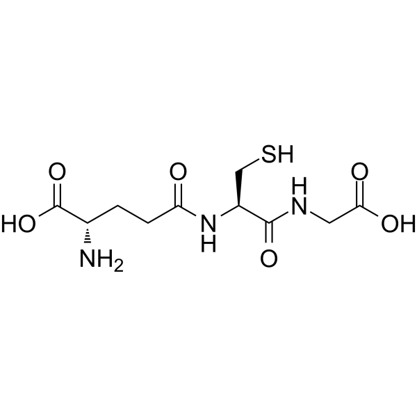

## Introduction

In the quest for optimal health and longevity, the importance of antioxidants cannot be overstated. One such remarkable peptide that has gained significant attention in recent years is glutathione. Known as the master antioxidant, glutathione plays a crucial role in maintaining cellular health and combating oxidative stress. In this blog, we will delve into the fascinating world of glutathione, exploring its functions, benefits, natural sources, and how it can be enhanced for therapeutic purposes.

1.  Understanding Glutathione:

Glutathione, often referred to as GSH, is a tripeptide composed of three amino acids: cysteine, glutamic acid, and glycine. It is naturally produced in our bodies and is found in almost every cell, acting as a potent shield against harmful free radicals.\
A study published in the Journal of Clinical Epidemiology found that higher levels of glutathione were associated with a reduced risk of age-related diseases, including cardiovascular disease, cancer, and neurodegenerative disorders. This suggests that maintaining optimal glutathione levels may contribute to healthy aging.\
Glutathione levels tend to decline with age, and research has suggested a potential link between low glutathione levels and age-related diseases, such as cardiovascular disease, neurodegenerative disorders, and cancer. Studies have explored the role of glutathione in mitigating age-related damage and promoting healthy aging.

2.  The Role of Glutathione as an Antioxidant:

Glutathione’s primary function lies in its remarkable antioxidant properties. As a powerful scavenger of free radicals, it neutralizes these harmful molecules, which are known to cause cellular damage and contribute to the aging process. By preventing oxidative stress, glutathione helps protect cellular DNA, proteins, and lipids from damage.\
Glutathione is a powerful antioxidant that helps protect cells from damage caused by reactive oxygen species (ROS) and free radicals. Numerous studies have explored the role of glutathione in reducing oxidative stress and maintaining cellular health.

3.  Health Benefits of Glutathione:

a) Immune System Support: Glutathione plays a crucial role in supporting a healthy immune system. It aids in the production and function of various immune cells, enhancing their ability to combat infections and diseases.\
Glutathione plays a critical role in immune system function by supporting the activity of immune cells and regulating inflammation. Studies have investigated the relationship between glutathione and immune responses, including its effects on fighting infections and reducing inflammation.\
Research published in the journal Nutrients highlights the role of glutathione in modulating immune function. It found that glutathione supplementation can enhance immune responses and improve the body’s ability to fight infections.

b) Detoxification: Glutathione acts as a natural detoxifier, aiding the liver in breaking down and eliminating harmful toxins from the body. It also helps in the metabolism of drugs and other foreign substances.\
Glutathione is involved in the detoxification of harmful substances, including drugs, pollutants, and heavy metals. Research has shown that glutathione levels are important for maintaining optimal liver function and protecting against liver damage.\
Research suggests the important role of glutathione in detoxification processes. It highlighted how glutathione aids in the elimination of harmful toxins and protects against oxidative damage, making it crucial for maintaining overall health.

c) Skin Health: Glutathione has gained popularity in the beauty industry due to its potential skin-lightening effects. By inhibiting the production of melanin, it helps reduce hyperpigmentation and promote a more even skin tone.\
A study published in the Journal of Clinical and Aesthetic Dermatology investigated the effects of glutathione on skin health. It found that oral glutathione supplementation led to a significant reduction in skin pigmentation and improved skin radiance and elasticity.\
Several studies have suggested a potential link between low glutathione levels and chronic diseases such as diabetes, Alzheimer’s disease, and Parkinson’s disease. These findings emphasize the importance of glutathione in preventing and managing these conditions.

4.  Natural Sources of Glutathione:

While our bodies naturally produce glutathione, several dietary sources can help boost its levels. Foods rich in sulfur-containing amino acids like cysteine, such as garlic, onions, cruciferous vegetables (broccoli, cauliflower), and eggs, can support glutathione synthesis. Additionally, consuming foods high in antioxidants, such as fruits, vegetables, and nuts, can indirectly enhance glutathione levels.

5.  Glutathione and Exercise Performance: Some research suggests that glutathione levels may influence exercise performance and recovery. Studies have examined the effects of glutathione supplementation on oxidative stress, muscle damage, and physical performance in athletes and active individuals.

## Conclusion

In conclusion, the benefits of glutathione are numerous and undeniable. This powerful antioxidant plays a crucial role in maintaining our overall health and well-being. From boosting immune function and detoxifying our bodies to protecting against chronic diseases and promoting skin health, glutathione proves to be an essential molecule for our optimal functioning.

Through its ability to neutralize harmful free radicals, support liver function, and enhance cellular health, glutathione has the potential to prevent and alleviate a wide range of health conditions. By incorporating glutathione-boosting foods, supplements , or lifestyle changes, individuals can support their body’s natural production of this vital antioxidant.

While more research is needed to fully understand the extent of glutathione’s benefits and its potential therapeutic applications, the existing evidence highlights its significance in promoting overall health and longevity. As we strive for a healthier lifestyle, considering the role of glutathione in our daily routine may prove to be a valuable step towards achieving optimal health and well-being.
