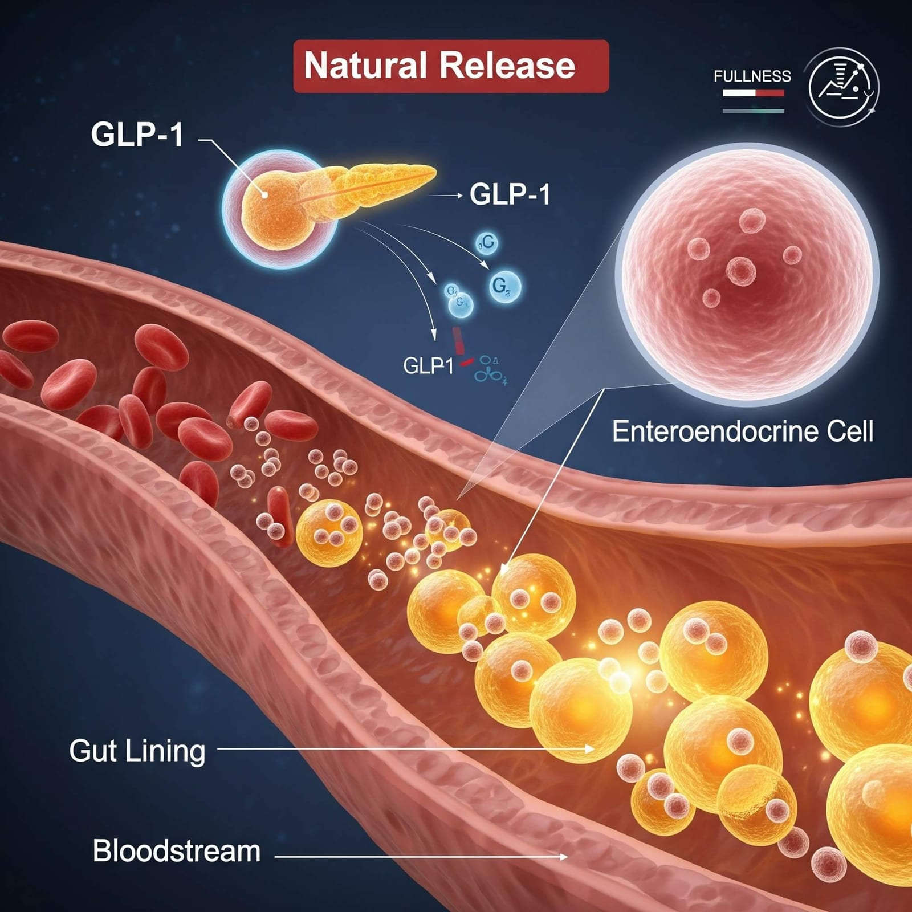

Let’s talk about what is really going on.

Because we have all heard the myths.

Eat less.\
Move more.\
You just need more willpower.\
You need to eat fewer calories.

But what is a calorie anyway?

A calorie is simply a measurement of energy. That is it. It tells us how much energy a food can provide, but it does not tell us what that food is actually doing inside your body.

It does not tell us whether that food is nourishing your cells.\
It does not tell us whether it is spiking your blood sugar.\
It does not tell us whether it is feeding inflammation.\
It does not tell us whether it is helping your gut bacteria or wrecking them.\
It does not tell us whether it is supporting your hormones or throwing them off.

[That is why the old “calories in, calories out” conversation is so incomplete.](/diet-advice-you-already-knew-but-needed-to-hear-again/) It makes weight loss sound like math, when the body is actually biology.

Think about it this way.

You can have 100 calories of chocolate chip cookies, or you can have 100 calories of broccoli.

Now technically, if we are only talking about calories, those are the same. But inside the body? They are not the same at all.

The cookies break down quickly into sugar. They spike blood sugar, raise insulin, increase cravings, and do very little to actually nourish the body. You may eat them and feel good for a minute, but then here comes the crash, the hunger, the cravings, and the “why am I still hungry?” conversation.

The broccoli is completely different. Broccoli gives your body fiber, minerals, antioxidants, plant nutrients, and food for your gut bacteria. It supports digestion. It helps move waste out. It supports detoxification. It helps stabilize blood sugar instead of spiking it.

So yes, they may both be 100 calories, but they are giving your body two completely different messages.

[That is why I do not believe real weight loss is about eating less.](/springfield/weight-loss/)

---

## Why Food Quality Matters More Than Calorie Counting
When we focus only on calories, we miss the bigger picture.

Food is not just energy. Food is information.

Every bite you take is telling your body something. It is either helping your body function better, or it is adding to the burden your body is already trying to manage.

Real, whole foods tell the body, “We have nutrients. We have minerals. We have fiber. We have what we need to build, repair, detoxify, and function.”

Processed foods tell a very different story.

They often come with refined sugar, poor-quality oils, additives, preservatives, artificial ingredients, and chemicals the body was never really designed to live on day after day. These foods may fill the stomach, but they do not truly nourish the body.

And when the body is undernourished, inflamed, and overwhelmed, weight loss becomes harder.

Not because you are lazy.\
Not because you failed.\
Not because you need to punish yourself with less food.

But because the body is trying to function in an environment that is not supporting it.

## Your Gut Is Not Just Along for the Ride
Now this is where gut health comes in, because we cannot talk about sustainable weight loss without talking about the gut.

People say “gut health” all the time now, but let’s break down what that actually means.

Your gut is not just your stomach. It is your entire digestive system. Its job is to break down food, absorb nutrients, help remove waste, protect you from harmful substances, and communicate with the rest of the body.

Your gut is also home to your microbiome, which is made up of trillions of bacteria and other organisms. Some are helpful. Some are not so helpful. The goal is not to have a perfectly sterile gut. The goal is balance.

When your gut is healthy, your good bacteria help with digestion, nutrient absorption, immune support, inflammation control, and hormone communication.

And yes, your gut also plays a role in weight loss.

Your gut communicates with your brain, your immune system, your metabolism, and your hormones. It helps regulate hunger, fullness, blood sugar, inflammation, and how efficiently your body processes food.

So when your gut is out of balance, weight loss can become much harder.

## Your Body Already Makes Natural GLP-1

This is also where we can connect the conversation to GLP-1.

[GLP-1 medications have gotten a lot of attention, and they can be very helpful tools when they are used appropriately.](/glp-1s-what-youre-hearing-vs-what-you-need-to-know/) But GLP-1 itself is not foreign to the body.

Your body already makes GLP-1 naturally.

GLP-1 is a hormone signal released in the gut. It helps regulate blood sugar, slows stomach emptying, improves fullness, and communicates with the brain about appetite.

In simple terms, GLP-1 helps tell your body, “We are satisfied. We do not need to keep eating. Blood sugar needs to stay controlled.”

That is a big deal.

But here is the part people miss: your gut environment matters.

If your gut is inflamed, your blood sugar is constantly spiking, your diet is full of processed foods, and your microbiome is out of balance, those natural signals may not work as well as they should.

That is why nutrition matters.

Whole foods, fiber, protein, healthy fats, hydration, and gut-supportive habits help create a better internal environment. They support your body’s natural hormone signals, including the ones that help regulate hunger and fullness.

So again, this is not just about eating less.

It is about helping the body function better.

## What Is a Healthy Gut?
A healthy gut has a strong protective lining.

That lining is supposed to be selective. It lets the good things through, like nutrients from your food, and helps keep the wrong things out, like toxins, waste products, and inflammatory particles.

Think of it like a really smart security system.

It knows what belongs inside the body and what needs to stay out.

But when that gut lining becomes irritated or damaged, it can become more permeable. That is what people are talking about when they use the term “leaky gut.”

Leaky gut means the barrier is not doing its job as well as it should. Things that should stay inside the digestive tract may start slipping through into the bloodstream.

That can include toxins, inflammatory particles, and partially digested food components.

And when those things get through, the immune system reacts.

That reaction can show up in a lot of different ways.

Bloating.\
Gas.\
Constipation or diarrhea.\
Brain fog.\
Fatigue.\
Joint discomfort.\
Skin issues.\
Cravings.\
Food sensitivities.\
Inflammation.\
Stubborn weight gain.

Not because the body is broken, but because the body is overwhelmed.

## Processed Foods Create Chaos in the Gut
Processed foods are not just “extra calories.”

That is where we have gotten this conversation wrong.

Highly processed foods can disrupt digestion, irritate the gut lining, feed the wrong bacteria, and contribute to inflammation. Over time, they can shift the gut environment in the wrong direction.

They can also contribute to biofilms, which are protective layers that unwanted organisms can use to hide and thrive in the gut. When that happens, it becomes harder for the good bacteria to do their job.

Now the friendly bacteria are being crowded out.\
The gut lining is irritated.\
Inflammation is increasing.\
Digestion slows down.\
Cravings get worse.\
Blood sugar gets harder to control.\
And weight loss gets harder.

This is why I always say we have to look at what is actually going on inside the body.

Because telling someone to “just eat less” when their gut is inflamed, their blood sugar is unstable, their hormones are off, and their body is overwhelmed is not helpful.

It is incomplete.

## The Cousin “Eddie” Gut Analogy

Here is how I like to explain it.

At first, it may not seem like a big deal. “Eddie”, you know, that cousin that everybody has, the one who just shows up at your door with a suitcase. Next thing you know, you come home from work, and his friends are all there. They come in, sit on the couch, make a little mess, and you think, “Okay, this is fine. I can handle this.”

But then they start dirtying up every dish in the kitchen.      They leave trash everywhere. They invite more people over. They take over the bedrooms. Their kids are running through the house. Nobody is cleaning up after themselves.

Before long, your clean, organized house is complete chaos.

And the people who actually belong there — the ones who are respectful, helpful, clean, and keeping things running — cannot even function anymore because the house has been taken over.

That is what processed foods, toxins, and inflammatory byproducts can do in the gut.

They create an environment where the wrong things can thrive, and the good bacteria get pushed out.

Now your gut is not working for you the way it should.

And when the gut is not working well, the rest of the body feels it

## This Is Where Detoxification Comes In
Now let’s talk about detoxification, because this is another word that gets thrown around a lot.

Detoxification is not about starving yourself.\
It is not about punishment.\
It is not about drinking weird juice for three days and hoping your liver forgives you.

True detoxification is about supporting the body’s natural ability to clear out what does not belong.

Your body is designed to detox every single day. Your liver, kidneys, gut, lymphatic system, skin, and lungs are all part of that process.

The problem is not that your body does not know how to detox.

The problem is that many people are overloaded.

Processed foods, sugar, alcohol, poor sleep, chronic stress, constipation, environmental toxins, inflammation, and hormone imbalance can all add to the burden.

At some point, the body is trying to take out the trash, but the trash keeps piling up faster than it can be removed.

That is when people start feeling sluggish, bloated, inflamed, tired, foggy, and stuck.

## Detoxification Is Cleaning the House
If processed foods are the unwanted relatives making a mess in the gut, detoxification is the process of taking your house back.

It is opening the windows.\
Taking out the trash.\
Washing the dishes.\
Cleaning the floors.\
Clearing the clutter.\
And making space for the right people to come back in.

But we do not do that by starving the body.

We do it by nourishing the body.

You support detoxification by eating real food, drinking enough water, getting enough fiber, supporting bowel movements, eating enough protein, reducing sugar and processed foods, moving your body, sweating, sleeping, and giving your gut the nutrients it needs to repair.

That is how the body starts to clear out what does not belong.

That is how the gut environment starts to shift.

That is how the good bacteria can start to come back in and do their job.

## You Can Eat More When You Eat the Right Foods
This is the part I wish more people understood.

When you are eating real, nutrient-dense food, you usually do not have to obsess over eating less.

Whole foods naturally help regulate appetite because they give the body what it actually needs.

Protein helps stabilize blood sugar and preserve muscle.\
Fiber feeds healthy gut bacteria and supports bowel movements.\
Healthy fats help with fullness and hormone production.\
Vegetables provide minerals, antioxidants, and detoxification support.\
Water helps move waste out of the body.

When the body is nourished, cravings often decrease.

Energy improves.\
Digestion improves.\
Blood sugar becomes more stable.\
Hormone signals work better.\
Inflammation can calm down.

That is sustainable weight loss.

Not restriction.\
Not punishment.\
Not white-knuckling your way through hunger.

It is learning how to feed your body in a way that works with your biology instead of fighting against it.

## Weight Loss Is a Whole-Body Conversation
This is why I talk about weight loss differently.

Weight loss is not just about the scale.

It is not just about calories.\
It is not just about medication.\
It is not just about willpower.

It is hormones.\
It is insulin.\
It is cortisol.\
It is gut health.\
It is inflammation.\
It is detoxification.\
It is sleep.\
It is stress.\
It is muscle.\
It is what you are eating every day and how your body is responding to it.

[GLP-1 medications can be powerful tools, but they work best when the foundation is being addressed too.](https://anewyouwomensclinic.myaestheticrecord.com/online-booking/memberships)

If we use medication but continue to ignore gut health, nutrition, inflammation, and lifestyle, we are missing the bigger picture.

The goal is not just to lose weight.

The goal is to restore function.

## Final Thoughts
So no, I do not believe weight loss is simply about eating less.

I believe it is about eating better.

It is about choosing foods that nourish your body, support your gut, balance your blood sugar, lower inflammation, and help your natural hormone signals work the way they were designed to work.

You do not have to starve your way into health.

You need to build a body that feels safe enough, nourished enough, and supported enough to let go of the weight it has been holding onto.

That starts with real food.\
It starts with your gut.\
It starts with understanding that your body is not broken.

It is communicating.

Now we just have to learn how to listen.
