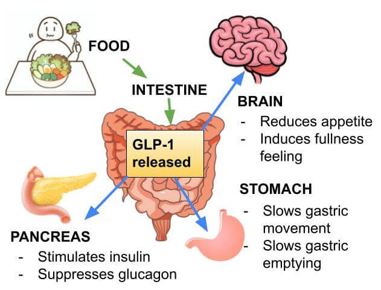
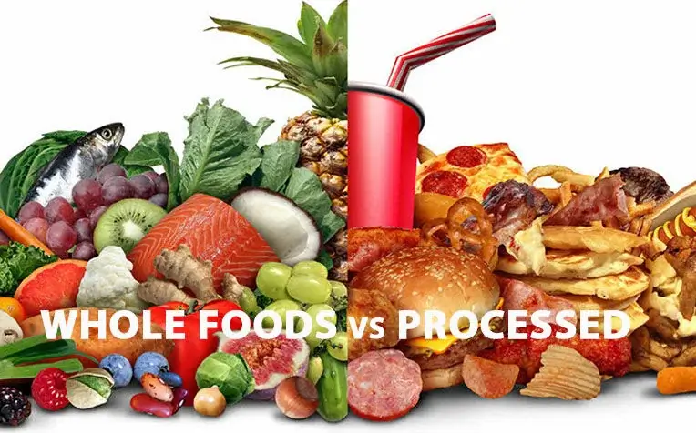

## You Finally Understand GLP-1s… Now Let’s Talk About Reality

GLP-1 medications like semaglutide and tirzepatide have changed the conversation around weight loss—and for good reason. They work with your body to regulate appetite, improve insulin sensitivity, and support fat loss in a way that feels more natural and sustainable.

But here’s the part no one talks about enough:

**These medications don’t fix everything.**

And if we don’t address what’s underneath the weight gain in the first place, we’re setting people up for frustration down the road.

## Weight Loss Was Never Just About Willpower
If you’ve followed me for any amount of time, you already know this:

Weight gain is not a willpower problem.\
**It’s a physiology problem.**

[We’ve talked about this before](/blog/diet-advice-you-already-knew-but-needed-to-hear-again/)—especially how insulin resistance and hormonal imbalance drive fat storage and make weight loss feel impossible

GLP-1 medications help regulate that system—but they don’t replace the need to support it.

## What GLP-1 Medications Actually Do
Let’s simplify it:

GLP-1 medications help your body:

-   Feel full sooner
-   Stay full longer
-   Reduce cravings
-   Improve blood sugar regulation
-   Lower insulin spikes

That’s powerful.

But they are a **tool**, not the whole plan.

## What They Don’t Fix

### 1\. Poor Food Quality
You can absolutely lose weight eating processed food on a GLP-1…

…but that doesn’t mean your body is healthy.

If your body is still:

-   Inflamed
-   Nutrient deficient
-   Dependent on processed foods

You’re not building long-term health—you’re just suppressing appetite.

---

### 2\. Muscle Loss
One of the biggest mistakes I see:

People lose weight… but they’re losing muscle too.

And muscle is your metabolic engine.

If you don’t:

-   Prioritize protein
-   Support lean muscle
-   Stay active

Your metabolism will slow down over time.

(And yes—[this becomes even more important as we age and fight muscle loss](/blog/the-importance-of-protein-for-preventing-muscle-wasting-as-we-age/) )

---

### 3\. Hormonal Imbalance Beyond Insulin

GLP-1s help insulin.

But what about:

-   Cortisol
-   Thyroid
-   Sex hormones

If those are off, weight loss will still feel like a battle.

---

### 4\. Emotional & Behavioral Patterns
GLP-1s reduce hunger…\
but they don’t address:

-   Emotional eating
-   Habitual eating
-   Eating out of routine vs. true hunger

If we don’t reconnect people to **real hunger cues**, the problem comes back when the medication stops.

## Are GLP-1 Medications Forever?
Higher-dose GLP-1 medications used for weight loss are typically meant to **correct a metabolic problem**, not necessarily be a lifelong high-dose solution.

But that doesn’t mean support ends there.

For many patients, there is a transition:

### Phase 1: Correct
-   Improve insulin resistance
-   Reduce inflammation
-   Initiate weight loss

### Phase 2: Stabilize
-   Support muscle and metabolism
-   Begin lowering the dose

### Phase 3: Maintain / Optimize
-   Lower-dose or microdosing approach (when appropriate)
-   Focus on long-term metabolic health

At lower doses, GLP-1 medications may continue to support the body—not just for weight loss, but for overall metabolic function.

👉 The goal is **strategic, individualized use** based on what your body needs.

## This Is Where Most Programs Get It Wrong
Most places hand you a prescription and send you on your way.

That’s not care.\
That’s a transaction.

At [A New You Women’s Clinic,](/) we do this differently.

## The Right Way to Use GLP-1 Medications
GLP-1s should be part of a **bigger picture plan**, not the entire plan:

-   Whole, real foods
-   Protein + muscle support
-   Hormone optimization
-   Education + sustainability

## Final Thought
GLP-1 medications are powerful.

But they are not magic.

**We’re not just trying to make you smaller.****\
****We’re trying to make you healthier.**

## Call to Action
[👉 Schedule your consultation\
👉 Or reserve your seat for our seminar:\
**“The Talk You Should’ve Had”**](/)
