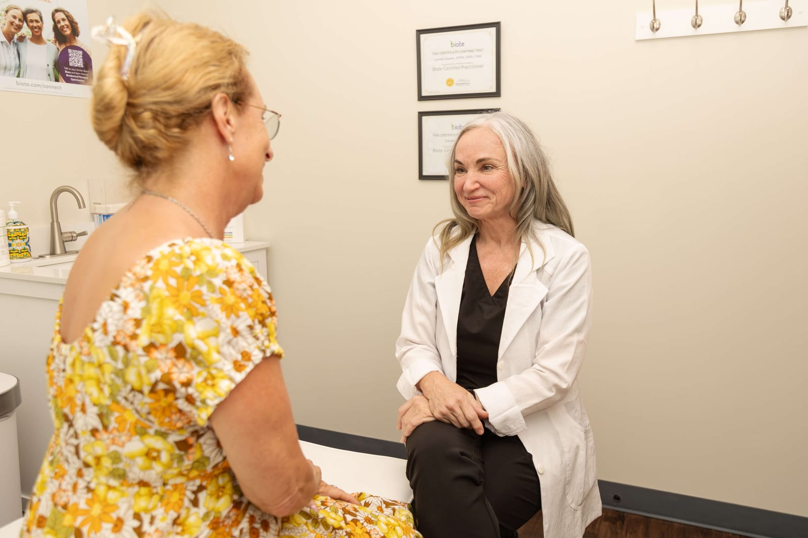
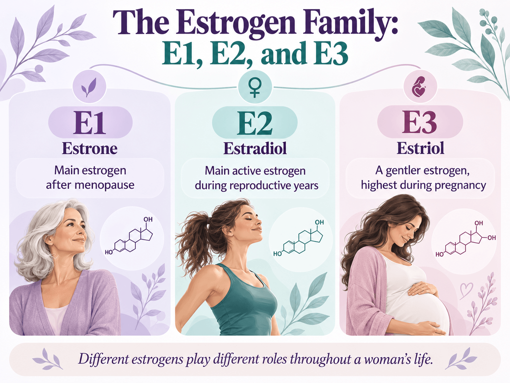
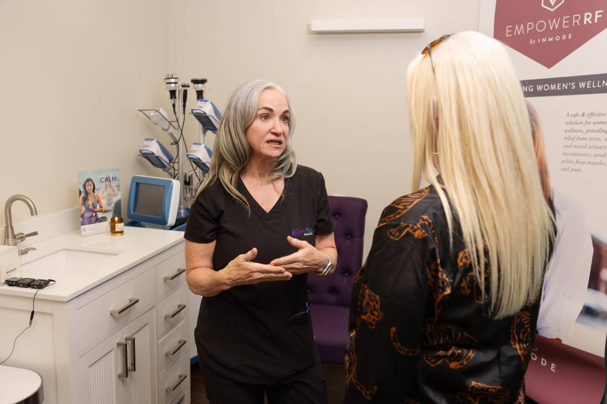

By [Lucinda “Cindy” Sparks, MSN, CNM, APRN](/about/), founder of A New You Women’s Clinic in Springfield, Missouri

When you hear “estrogen,” what comes to mind? Periods? Pregnancy? Hot flashes?

Those are parts of the story. But estrogen has a role in your brain, bones, skin, bladder, vagina, and much more.

**Estrogen helps cells throughout your body communicate.** That is why it deserves a place in the conversation about your whole health.

At A New You Women’s Clinic in Springfield, Missouri, I want women to understand what is happening in their bodies. You deserve more than being told to accept every change that comes with age.

Before we talk about symptoms, labs, or hormone therapy, let’s start at the beginning.

This article comes from [Chapter 1 of my Head to Hoo-Ha estrogen series on YouTube](https://www.youtube.com/watch?v=lFtNFnvPVGU). You can watch the full lesson or learn the basics here.

## Estrogen Is a Family of Hormones

Estrogen is the name for a group of related hormones. Hormones are chemical messengers that carry signals between cells and tissues.

Your body makes estrogen naturally. Some medicines also contain estrogen or change how it works.

The three main estrogens are:

-   **Estradiol, or E2:** The main estrogen in the bloodstream during the reproductive years.

-   **Estrone, or E1:** A form that becomes more prominent after [menopause](/springfield/menopause/).

-   **Estriol, or E3:** A form made in large amounts during pregnancy.

You do not need to memorize those names today. Just know that “estrogen” means a family of hormones, rather than one single substance.

## Think of Hormones as Text Messages

I like to compare hormones to text messages.

A message may help tell a cell to grow, maintain bone, repair tissue, or change how it uses energy.

The hormone carries the message. The cell does the work.

But the cell needs a way to receive that message. That is where **receptors** come in.

Think of estrogen as a key and an estrogen receptor as a lock. When the key meets the right lock, signals can begin inside the cell.

It is a simple picture of a complex process. Different cells have different receptors and other signals that shape their response.

That helps explain why estrogen does something different in a bone cell than it does in a breast cell or a vaginal cell.

## Where Does Your Body Make Estrogen?

Before menopause, your ovaries make most of the estradiol in your bloodstream.

Other tissues have a part, too. Fat tissue can turn other hormones into estrogen. The adrenal glands supply hormones that other tissues can use to make estrogen.

During pregnancy, the placenta becomes a major source.

After menopause, the ovaries make much less estrogen. **That does not mean your body makes none at all.** Other tissues still make and convert smaller amounts.

## Estrogen Reaches Beyond Your Period

Estrogen receptors are found in many parts of the body. That gives estrogen a role far beyond menstrual cycles and pregnancy.

Here are some of the places we will explore in this series:

**Brain:** Estrogen takes part in signals tied to mood, memory, and brain function.

**Bones:** It helps maintain the balance between bone loss and bone renewal.

**Heart and blood vessels:** It influences how blood vessels function and respond.

**Skin:** It has a role in collagen and tissue health.

**Bladder and vagina:** It helps support tissues involved in urinary health, comfort, and intimacy.

**Metabolism:** It takes part in how the body stores and uses energy.

Breast tissue, muscles, and other organs can respond to estrogen, too.

Does that mean estrogen runs the whole show? No. It is one important member of a much larger team.

Thyroid hormones, insulin, progesterone, testosterone, sleep, food, movement, and stress all belong in that conversation.

**Your body works as a whole. Your care should look at the whole picture, too.**

## Why Estrogen Changes Throughout Life

Estrogen does not stay at one level from puberty onward.

It rises during puberty and shifts throughout the menstrual cycle. Pregnancy brings another major change.

During [perimenopause](/springfield/perimenopause/), the years leading up to menopause, estrogen can swing up and down. It does not always follow a smooth decline.

After menopause, estradiol generally stays much lower than it was during the reproductive years.

That is one reason your body may feel different at 35, 45, or 55. The hormone setting has changed, even though you are still you.

## One Symptom Does Not Tell the Whole Story

Poor sleep. Brain fog. Dryness. Changes in weight. Pain with sex.

These concerns deserve attention. Some may involve estrogen changes, but they can also have other causes.

**Symptoms are clues. They are not a diagnosis.**

And a lab result is one piece of information. It needs to make sense alongside your symptoms, cycle, medicines, health history, and stage of life.

Routine hormone testing is not needed to identify perimenopause in many women. Testing should answer a useful clinical question, rather than replace a careful conversation.

When we talk about [hormone optimization in Springfield, MO](/biote/), that whole-person assessment matters. The goal is to understand what is contributing to how you feel.

## What About Weight and Metabolism?

If your body feels different and your usual habits are no longer giving you the same results, I want to hear about it.

Estrogen is part of the metabolic picture. So are muscle, sleep, food, movement, insulin, medicines, and other health conditions.

Estrogen therapy is not a weight-loss treatment. A change in weight does not, by itself, prove that you need estrogen.

At our [Springfield, Missouri weight loss clinic](/springfield/weight-loss/), we consider those connections as part of an individual plan.

My [blog about hormone therapy and whole-person health](/hormone-therapy-its-time-to-rethink-what-youve-been-told/) continues that conversation.

## Understanding Estrogen Gives You Choices

Learning about estrogen does not commit you to a prescription, a pellet, or any other treatment.

It helps you ask better questions:

Could hormone changes be contributing to what I feel?

What else should we consider?

Would testing help answer a specific question?

What options fit my symptoms, health history, and goals?

If hormone therapy is an option, we need to talk about its benefits and risks for you. Estrogen’s natural role in the body does not mean treatment is right for every woman.

*Knowledge gives you choices.* That is why I teach this series.

## Let’s Talk About Your Whole Health in Springfield

I am Lucinda “Cindy” Sparks, MSN, CNM, APRN, founder of A New You Women’s Clinic. My work centers on helping women understand their health and take part in decisions about their care.

If you are looking for hormone care in Springfield, Missouri, bring your questions. Tell me what has changed and what is affecting your daily life.

We will look at the whole woman sitting in front of me, from head to hoo-ha.

[Schedule an appointment with A New You Women’s Clinic](https://anewyouwomensclinic.myaestheticrecord.com/online-booking) or call (417) 605-2153.

Find us at 1426 E. Bradford Parkway, Suite C, Springfield, MO 65804.

Next, we will look more closely at estrogen receptors. [Watch Chapter 2 on how your cells hear estrogen](https://www.youtube.com/watch?v=L-gOU3fD0m8).

*In the meantime, stay beautiful and be well.*

## Sources and Further Reading

[Lucinda “Cindy” Sparks — What Is Estrogen? Head to Hoo-Ha, Chapter 1](https://www.youtube.com/watch?v=lFtNFnvPVGU)

[Endocrine Society — Reproductive Hormones](https://www.endocrine.org/patient-engagement/endocrine-library/hormones-and-endocrine-function/reproductive-hormones)

[Johns Hopkins Medicine — Estrogen’s Effects on the Female Body](https://www.hopkinsmedicine.org/health/conditions-and-diseases/estrogens-effects-on-the-female-body)

[ACOG — The Menopause Years](https://www.acog.org/womens-health/faqs/the-menopause-years)

[ACOG — Hormone Testing Before Hormone Therapy](https://www.acog.org/womens-health/experts-and-stories/ask-acog/hormone-testing-before-hormone-therapy)

[Faltas, Lebron, and Holz — Extranuclear Signaling by Estrogen](https://doi.org/10.1210/endocr/bqaa030)
