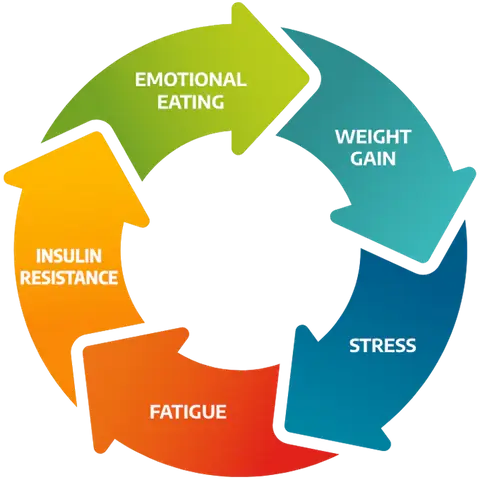
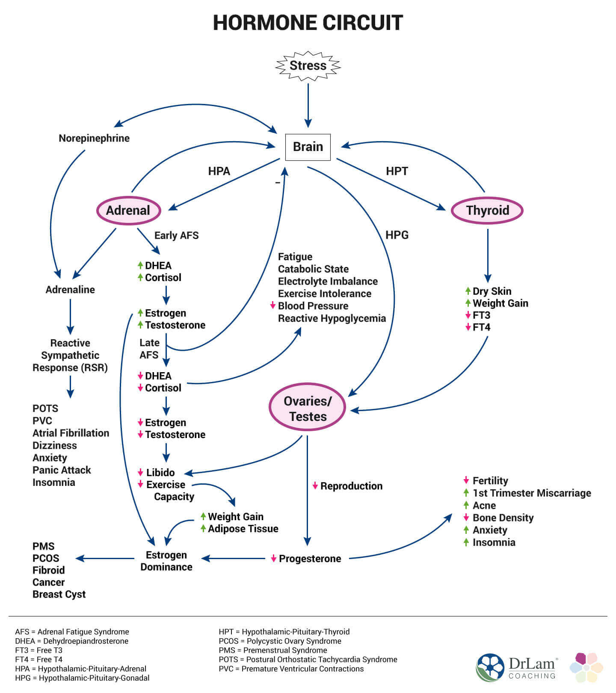

## If You Feel Like You’ve Tried Everything… You’re Not Wrong
Most women I see walk in saying:

“I’ve tried everything.”

And I believe them.

Because the problem isn’t effort.\
**It’s approach.**

## Weight Loss Isn’t a Food Problem—It’s a Body Problem
For years, we’ve been told:

Eat less. Move more.

But we now understand that weight gain is driven by:

-   Insulin resistance
-   Hormonal imbalance
-   Metabolic dysfunction

This is why traditional dieting fails—it ignores how the body actually works

## Why Diets Work… Until They Don’t
You lose weight… then:

-   Hunger increases
-   Energy drops
-   Weight plateaus
-   Weight comes back

That’s not failure.

👉 That’s physiology.

## So What Makes Medical Weight Loss Different?
Medical weight loss works because we stop guessing.

We identify what’s actually happening in your body.

---

### 1\. We Address Hormones First
We look at:

-   Insulin
-   Thyroid
-   Cortisol
-   Sex hormones

Because if those are off, nothing else sticks.

---

### 2\. We Use Tools Like GLP-1s Strategically
GLP-1s are powerful—but they are used with intention.

Not blindly.\
Not forever at high doses.

We use them to:

-   Correct
-   Then transition
-   Then maintain (when appropriate)

---

### 3\. We Protect Your Metabolism
Weight loss without muscle = long-term failure.

We focus on:

-   Protein
-   Muscle preservation
-   Metabolic health

([And yes—this matters more as we age](/blog/the-importance-of-protein-for-preventing-muscle-wasting-as-we-age/) )

---

### 4\. We Teach You How to Maintain Results
This is the missing piece everywhere else.

We teach:

-   Hunger awareness
-   Blood sugar balance
-   Sustainable habits

## This Is Why Our Patients Succeed
Not because of a magic plan…

But because they are:

-   Supported
-   Educated
-   Monitored
-   Adjusted along the way

## The Missing Piece Isn’t Motivation—It’s Support
You don’t need more discipline.

You need:

-   A clear plan
-   Medical guidance
-   Consistency

## Final Thought
If you’ve been stuck…

It’s not you.

It’s the approach.

---

## Call to Action
[👉 Schedule your consultation\
👉 Or reserve your seat for our seminar:\
**“The Talk You Should’ve Had”**](/)
